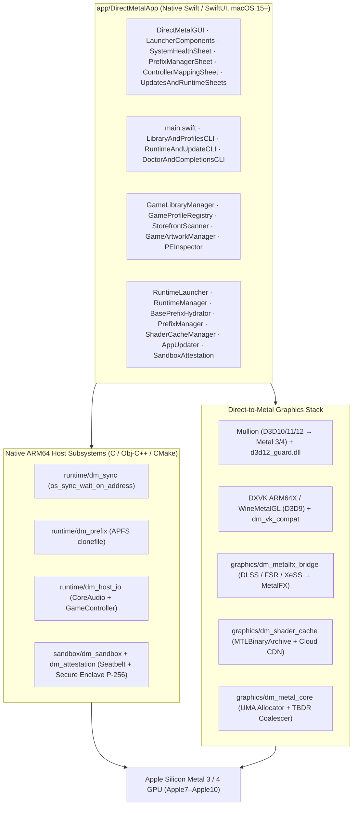

# DirectMetal Architecture

DirectMetal is a native Apple Silicon (`arm64`) DirectX 9/10/11/12 runtime and SwiftUI game launcher built around five core invariants:

1. **Apple Silicon First (`M1` – `M5`, `arm64` native):** Zero Intel x86-64 Mac support, zero X11, zero Rosetta 2 on macOS 26.4+.
2. **Direct-to-Metal 3/4 (`FL 12_2`):** Translates DXBC/DXIL directly to Apple Metal (`Mullion` / `DXMT`) with native **MetalFX Spatial** and **Metal 4 MetalFX Temporal** upscaling — no Vulkan/MoltenVK middleman for D3D10–12.
3. **UMA Zero-Copy & TBDR Native:** Treats unified memory (`MTLStorageModeShared`) and on-chip tile SRAM (`MTLStorageModeMemoryless`) as first-class allocation and pass-coalescing invariants.
4. **Instant Isolation & Zero-Stutter Launch:** `0.25–0.41 ms` APFS Copy-on-Write (`clonefile(2)`) prefixes, `~150 ms` dehydrated base-prefix hydration, persistent warm `wineserver` pooling (`70–100 ms` repeat launches), and double-SHA-256 verified `MTLBinaryArchive` Cloud Shader Caches (`67×–254×` warm load).
5. **Reference-Verified Correctness:** Every graphics feature and SM 6.0 engine pattern is validated pixel-for-pixel (**`25 / 25`**, `Mean SSIM >= 0.9998`) against a native Windows 11 + NVIDIA RTX 3070 oracle.

---

## High-Level Data Flow

---

## Subsystem Map

| Layer | Directory | Responsibility & Key Technologies |
| :--- | :--- | :--- |
| **App & Launcher** | `app/DirectMetalApp/` | Modular SwiftUI launcher & unified CLI: Steam/GOG/Epic auto-scanners, stat-cached `PEInspector` (D3D9–12/Vulkan/OpenGL + DLSS/FSR/XeSS detection), pure-Swift PE `.exe` icon decoder, 50 community profiles, playtime tracking, controller remapper (`GCController` → `SDL_GAMECONTROLLERCONFIG`), `DirectMetal-Lite` on-demand runtime installer, SHA-256 + `codesign` DMG self-updater, and in-app System Health & APFS Prefix Manager sheets. |
| **ARM64 Host Runtime** | `runtime/` | Native `arm64` Wine 11.22 + `USync 6` + `ARM64EC + FEX-Emu` (64-bit & 32-bit zero-Rosetta on macOS 26.4+), `dm_sync` (`os_sync_wait_on_address`), `dm_prefix` (`clonefile(2)`), `dm_host_io` (CoreAudio + `GameController.framework`), and `runtime/profiles/game_profiles.json`. |
| **Graphics & Upscaling** | `graphics/` | Direct-to-Metal `Mullion`/`DXMT`, `dm_metal_core` (UMA zero-copy + TBDR pass coalescer), `dm_metalfx_bridge` (MetalFX Spatial & Temporal), `dm_shader_cache` (`MTLBinaryArchive` keyed by `<gpu_family>_<macos_build>`), `dm_d3d12_placed_guard` (`d3d12_guard.dll` UE5 placed-resource alignment guard), and `dm_vk_compat` (Vulkan compatibility shim). |
| **Sandbox & Attestation** | `sandbox/` | Per-game macOS kernel Seatbelt confinement (`sandbox/profiles/directmetal_game.sb.tmpl`, blocking sibling prefixes, keychains, SSH/AWS/browser profiles, and optional outbound IP) + Secure Enclave ECDSA P-256 challenge-response attestation (`dm_attestation`). |
| **Packaging & CI** | `scripts/`, `.github/` | `package_app.sh` (`DirectMetal-Lite.app` `2.9 MB` & dehydrated/hardlink-deduped offline `DirectMetal.app` `3.7 GB`), `build_dmg.sh` (ULFO/ULMO + optional Notarytool), `dehydrate_base_prefix.py`, `dedup_bundle_hardlinks.py`, `validate_profiles.py`, `publish_shader_cache.sh`, `run_ci_local.sh`, and GitHub Actions `macos-15` CI/Release workflows. |
| **Automated Tests** | `tests/`, `tools/` | `tests/swift/DirectMetalTests.swift` (25+ native Swift unit tests), `tests/python/test_packaging_tools.py` (22+ packaging/profile/publisher tests), `tools/diff_harness.py` + `test_diff_harness.py` (vectorized PSNR/SSIM oracle diffing), and 8 native C/Obj-C++ subsystem test binaries. |
