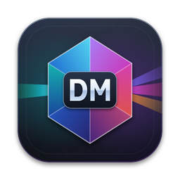
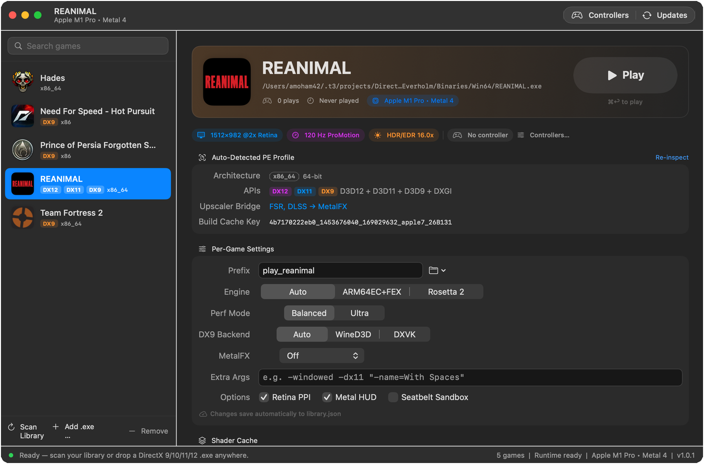
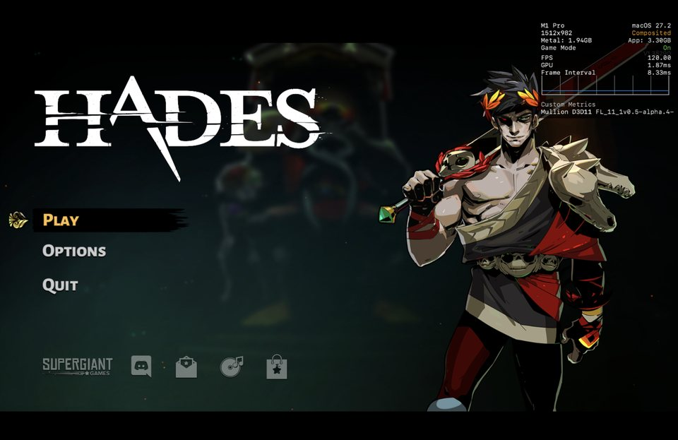
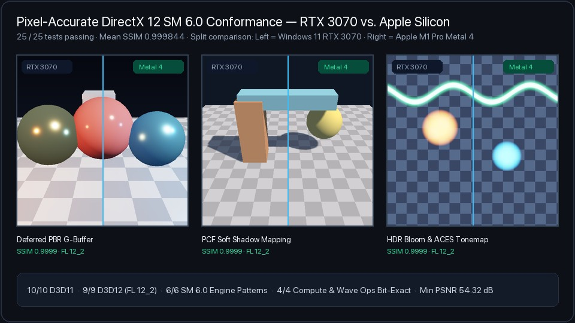
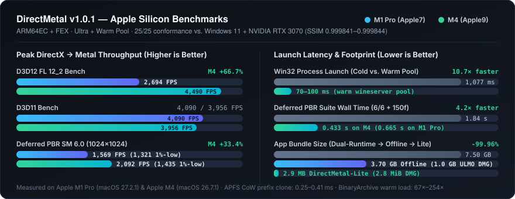
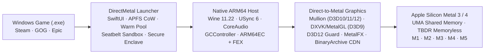

<div align="center">



# DirectMetal

**Run Windows DirectX 9 / 10 / 11 / 12 games natively on Apple Silicon — no bottles, no Rosetta 2, no Vulkan middleman.**

[](https://github.com/amoham42/DirectMetal/actions/workflows/ci.yml)
[](https://github.com/amoham42/DirectMetal/releases/latest)
[](LICENSE)
[](#system-requirements)

[Download v1.0.1](https://github.com/amoham42/DirectMetal/releases/latest) · [Quick Start](#-quick-start) · [Benchmarks](#-benchmarks) · [Compatibility](COMPATIBILITY.md) · [Architecture](ARCHITECTURE.md) · [Contributing](CONTRIBUTING.md)

</div>

---

<p align="center">
  <picture>
    <source media="(prefers-color-scheme: dark)" srcset="docs/assets/directmetal-launcher-dark.png" />
    <source media="(prefers-color-scheme: light)" srcset="docs/assets/directmetal-launcher-light.png" />
    
  </picture>
</p>
<p align="center">
  <sub><b>DirectMetal v1.0.1</b> — Native SwiftUI launcher auto-detecting PE APIs (<code>DX12</code> / <code>DX11</code> / <code>DX9</code>), DLSS/FSR → MetalFX bridges, embedded Windows <code>.exe</code> icons, Retina PPI, ProMotion 120 Hz &amp; HDR/EDR</sub>
</p>

<p align="center">
  
  
</p>
<p align="center">
  <sub><b>Left:</b> <i>Hades</i> (DX11, Seatbelt sandboxed) locked at <b>120.00 FPS · 1.87 ms GPU</b> on Apple M1 Pro &nbsp;|&nbsp; <b>Right:</b> Live split-frame ground truth — <b>Windows 11 RTX 3070 vs. Apple Silicon Metal 4</b> (<code>25/25</code> passing, <code>SSIM 0.9999</code>)</sub>
</p>

## Why DirectMetal?

Traditional Mac gaming wrappers stack layers (`DirectX → Vulkan → MoltenVK → Metal`) and push users into manual bottles, DLL overrides, and backend switches. **DirectMetal** is built from the ground up for Apple Silicon (M1 through M4/M5):

- **Direct-to-Metal 3/4 (`FL 12_2`):** Translates DXBC/DXIL directly to Apple Metal (`Mullion` / `DXMT`) with native **MetalFX Spatial** and **Metal 4 MetalFX Temporal** upscaling — no Vulkan middleman for DX10–12.
- **100% Post-Rosetta ARM64EC + FEX:** Runs both **64-bit and 32-bit** Windows games on a native `arm64` host (`Wine 11.22` + `USync 6` + `FEX-Emu`) with zero Rosetta 2 on macOS 26.4+ (plus optional `--include-rosetta` fallback for macOS 15–26.3).
- **`2.8 MiB` Lite Installer & Verified Self-Updater:** Ships as a `2.9 MB` `DirectMetal-Lite.app` that downloads and SHA-256 + `codesign` verifies `MetalSharp-Wine` on first launch — or grab the `1.3 GB` self-contained offline DMG.
- **Instant Launches & Zero Stutter:** Persistent warm `wineserver` pool (**`70–100 ms`** repeat launches, `10.7×` faster), **`0.25–0.41 ms`** APFS CoW prefixes, `~150 ms` zero-copy prefix hydration, and double-SHA-256 verified **Cloud Shader Cache CDN** (`MTLBinaryArchive`, `67×–254×` warm load).
- **Consumer Game Library & Controller Remapper:** Auto-discovers **Steam, GOG Galaxy, and Epic Games Store** installs with real storefront artwork + embedded Windows PE `.exe` icons, **50 community game presets**, Retina PPI + ProMotion/EDR telemetry, and interactive `GCController` remapping + deadzones.
- **Hardened Per-Game Sandbox & Attestation:** Opt-in macOS kernel Seatbelt confinement (`--sandbox`) and Apple Silicon Secure Enclave P-256 hardware attestation (`DirectMetal attest`).

---

## 🚀 Quick Start

### 1. Download & Install (Fastest)

**Via Homebrew Cask:**
```bash
brew install --cask https://raw.githubusercontent.com/amoham42/DirectMetal/main/Casks/directmetal.rb
```

**Or direct DMG download:**
1. Grab **[`DirectMetal-Lite-macOS-arm64.dmg` (`2.8 MiB`)](https://github.com/amoham42/DirectMetal/releases/latest)** *(or the `1.3 GB` offline DMG)*.
2. Drag **`DirectMetal-Lite.app`** into `/Applications`.
3. *(Until Apple Developer ID notarization is enabled on CI)* clear macOS quarantine once:
   ```bash
   xattr -dr com.apple.quarantine "/Applications/DirectMetal-Lite.app"
   ```
4. Launch **DirectMetal** — it automatically downloads, SHA-256 verifies, and code-sign checks the ARM64EC runtime on first run, then scans your games.

### 2. Play from the CLI (Optional)

```bash
DM="/Applications/DirectMetal-Lite.app/Contents/MacOS/DirectMetal"

"$DM" library scan                    # Auto-discover Steam, GOG, Epic & local games
"$DM" library play Hades --warm-server
"$DM" update apply                    # Self-update DirectMetal with SHA-256 + codesign checks
```

### 3. Build from Source (`~25 s`)

```bash
git clone https://github.com/amoham42/DirectMetal.git
cd DirectMetal
make app-lite        # Builds dist/DirectMetal-Lite.app (~2.9 MB)
make ci              # Runs lint, Python diff tests, all 8 C/Obj-C++ subsystem tests & smoke checks
```

---

## 📊 Benchmarks

<p align="center">
  
</p>

Verified pixel-accurately (**`25 / 25` passing**, `10/10` D3D11 · `9/9` D3D12 `FL 12_2` · `6/6` SM 6.0 Engine Patterns) against a native **Windows 11 + NVIDIA RTX 3070** ground-truth oracle:

| Machine | GPU Family | macOS | Conformance vs. RTX 3070 | D3D12 `FL 12_2` | Deferred PBR (1024²) | Warm Launch |
| :--- | :--- | :--- | :--- | ---: | ---: | ---: |
| **Apple M1 Pro** (`MacBookPro18,3`) | `Apple7` (14-core) | `27.2.1` | **`25 / 25`** (`SSIM 0.999841`) | **`2,694 FPS`** (`0.738 s`) | **`1,569 FPS`** (`0.665 s`) | **`70 ms`** (`10×`) |
| **Apple M4** (`Mac16,1`, Lite) | `Apple9` (10-core) | `26.7.1` | **`25 / 25`** (`SSIM 0.999844`) | **`4,490 FPS`** (`0.490 s`) | **`2,092 FPS`** (`0.433 s`) | **`100 ms`** (`10.7×`) |

See full frame-time breakdowns, 1%-lows, and live retail game telemetry in [COMPATIBILITY.md](COMPATIBILITY.md) and [docs/ENGINE_COMPATIBILITY_MATRIX.md](docs/ENGINE_COMPATIBILITY_MATRIX.md).

---

## 🧱 Architecture



---

## 💻 System Requirements

| Requirement | Minimum | Recommended |
| :--- | :--- | :--- |
| **Chip** | Any Apple Silicon Mac (**M1 / M2 / M3 / M4 / M5**) | M1 Pro / M3 / M4+ (`16 GB+` UMA for UE5 DX12) |
| **macOS** | **macOS 15.0 Sequoia** *(64-bit ARM64EC; `--include-rosetta` for 32-bit)* | **macOS 26.4+ / 27.x** *(100% post-Rosetta 64-bit & 32-bit, `FL 12_2`, Metal 4)* |
| **Intel Macs** | Not supported (`arm64` native only) | — |

---

<details>
<summary><b>🛠 Full CLI &amp; Developer Command Reference</b></summary>

```bash
# Game Library (Steam, GOG Galaxy, Epic Games Store & local folders)
DirectMetal library scan
DirectMetal library list
DirectMetal library set Hades perf=ultra retina=true hud=true sandbox=true
DirectMetal library artwork Hades
DirectMetal library play Hades --warm-server

# Diagnostics, Runtime, Self-Updater & Cloud Shader Cache CDN
DirectMetal doctor --json             # 9-point Apple Silicon health & readiness check
DirectMetal completions zsh           # Native zsh/bash tab completions
DirectMetal runtime status --json
DirectMetal runtime install
DirectMetal runtime update
DirectMetal update check --json
DirectMetal update apply
DirectMetal cache list                # Inspect local shader caches (current vs stale builds)
DirectMetal cache prune --dry-run     # Reclaim disk space from old macOS build caches
DirectMetal cache sync https://github.com/amoham42/DirectMetal/releases/download/v1.0.1/shader-cache-index.json --exe /path/to/game.exe

# Interactive Controller Remapping & Hardware Telemetry
DirectMetal info
DirectMetal profiles list
DirectMetal controller set default preset=nintendoSwap left-deadzone=12 right-deadzone=12
DirectMetal controller show --json

# Seatbelt Sandbox & Hardware Secure Enclave Attestation v2
DirectMetal run /path/to/game.exe --sandbox --perf-mode ultra --upscale quality
DirectMetal attest --pid $$ --nonce aabbccdd00112233 --sandbox > /tmp/attest.json
DirectMetal verify-attest /tmp/attest.json --nonce aabbccdd00112233

# Packaging & Local CI
make help           # Show all Makefile targets
make ci             # Run full local CI gate (~26 s)
make app-lite       # Build DirectMetal-Lite.app (~2.9 MB)
make dmg-lite       # Build DirectMetal-Lite-macOS-arm64.dmg (~2.8 MiB)
make dmg            # Build offline DirectMetal-macOS-arm64.dmg (1.3 GB ULFO)
make dmg-ultra      # Build max-compression offline DMG (1.0 GB ULMO LZMA)
```

</details>

---

## 📚 Documentation & Contributing

| Document | Description |
| :--- | :--- |
| [ARCHITECTURE.md](ARCHITECTURE.md) | DirectX-to-Metal stack, UMA/TBDR optimizations, and ARM64EC + FEX design |
| [docs/CLI_REFERENCE.md](docs/CLI_REFERENCE.md) | Complete CLI subcommand, flag, and environment-variable reference |
| [docs/BENCHMARKS.md](docs/BENCHMARKS.md) | Reproducible M1 Pro vs. M4 vs. RTX 3070 throughput, microbenchmark & bundle-size tables |
| [docs/COMPARISON.md](docs/COMPARISON.md) | Honest comparison vs. Whisky, CrossOver, Kegworks, and Apple GPTK |
| [docs/GAME_PROFILES_GUIDE.md](docs/GAME_PROFILES_GUIDE.md) | How community presets work, local overrides, and schema validation |
| [docs/SHADER_CACHE_CDN.md](docs/SHADER_CACHE_CDN.md) | `MTLBinaryArchive` hardware keying, double-SHA-256 sync & stale cache pruning |
| [docs/TROUBLESHOOTING.md](docs/TROUBLESHOOTING.md) | Fixes for quarantine, macOS 15 Rosetta fallback, Retina PPI, Steam & warm servers |
| [COMPATIBILITY.md](COMPATIBILITY.md) | Full 25/25 PSNR/SSIM conformance tables and M1 Pro / M4 vs. RTX 3070 benchmarks |
| [docs/ENGINE_COMPATIBILITY_MATRIX.md](docs/ENGINE_COMPATIBILITY_MATRIX.md) | Engine & retail game test telemetry (UE5, Source, DX9/11/12) |
| [CONTRIBUTING.md](CONTRIBUTING.md) | 60-second dev loop, CMake/Swift build guide, adding presets to [`game_profiles.json`](runtime/profiles/game_profiles.json) |
| [SECURITY.md](SECURITY.md) | Seatbelt confinement, Secure Enclave attestation, and SHA-256 verification model |
| [CHANGELOG.md](CHANGELOG.md) | Versioned release history |
| [ROADMAP.md](ROADMAP.md) | Completed Phases 0–4 milestones |

Contributions are welcome — especially new verified entries in [`runtime/profiles/game_profiles.json`](runtime/profiles/game_profiles.json) and Apple Silicon GPU family shader caches! See [CONTRIBUTING.md](CONTRIBUTING.md) to get started.

## 📄 License

[MIT License](LICENSE) © 2026 DirectMetal Contributors.
